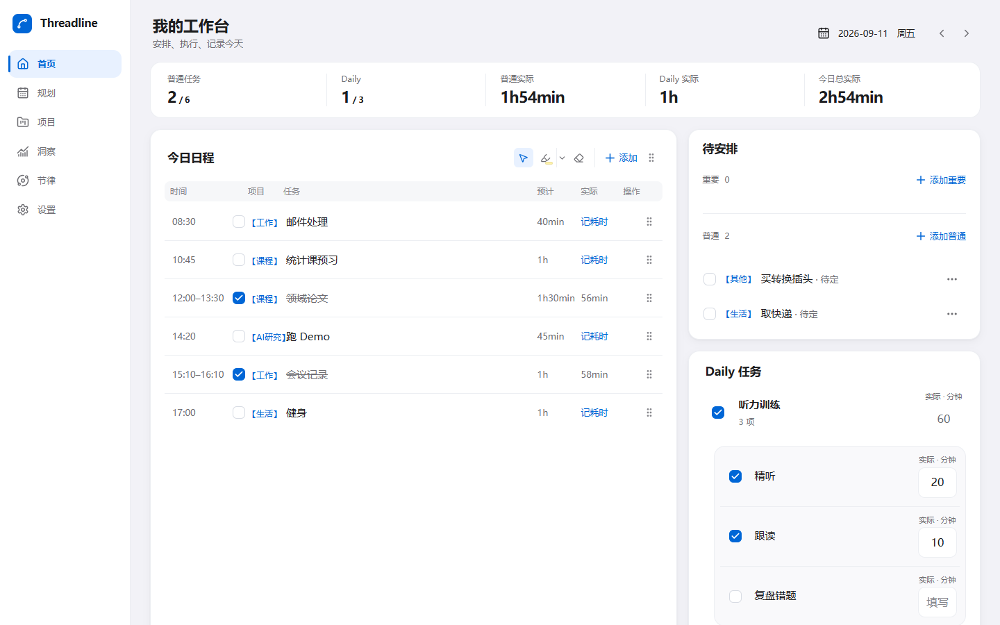
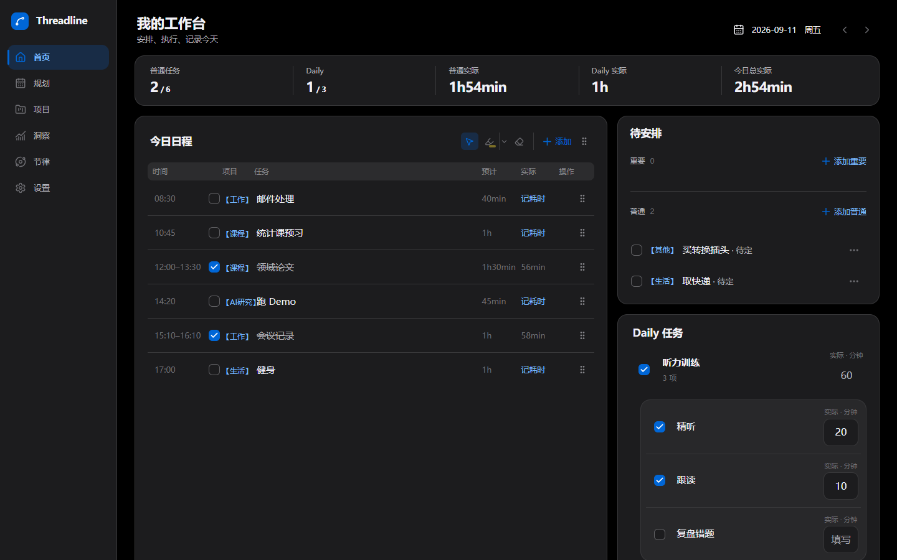
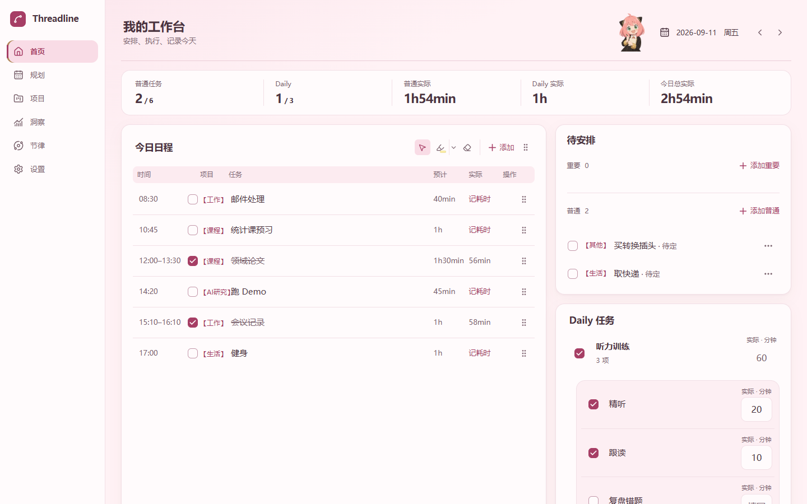
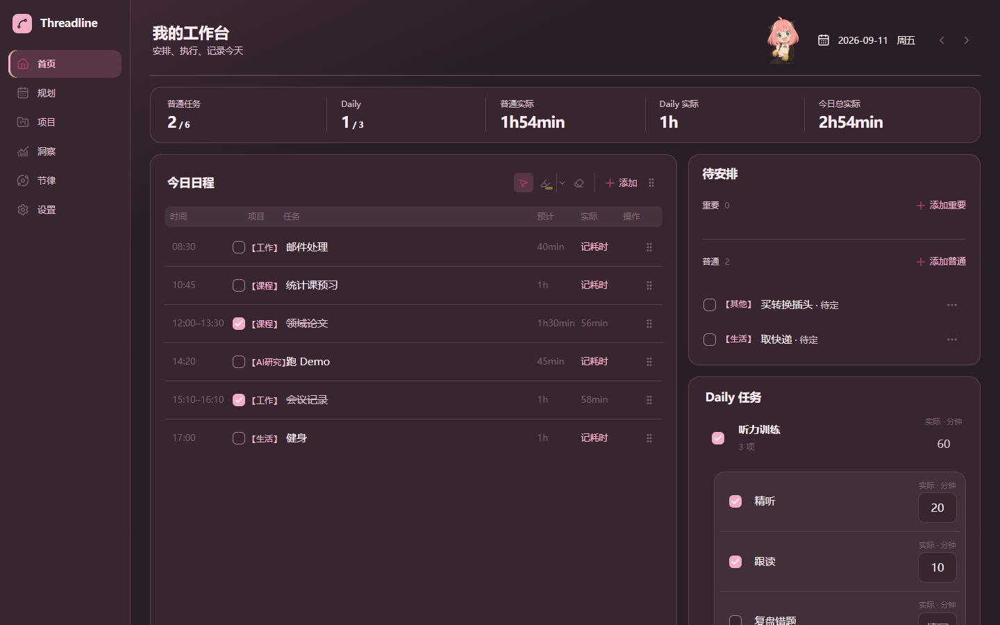
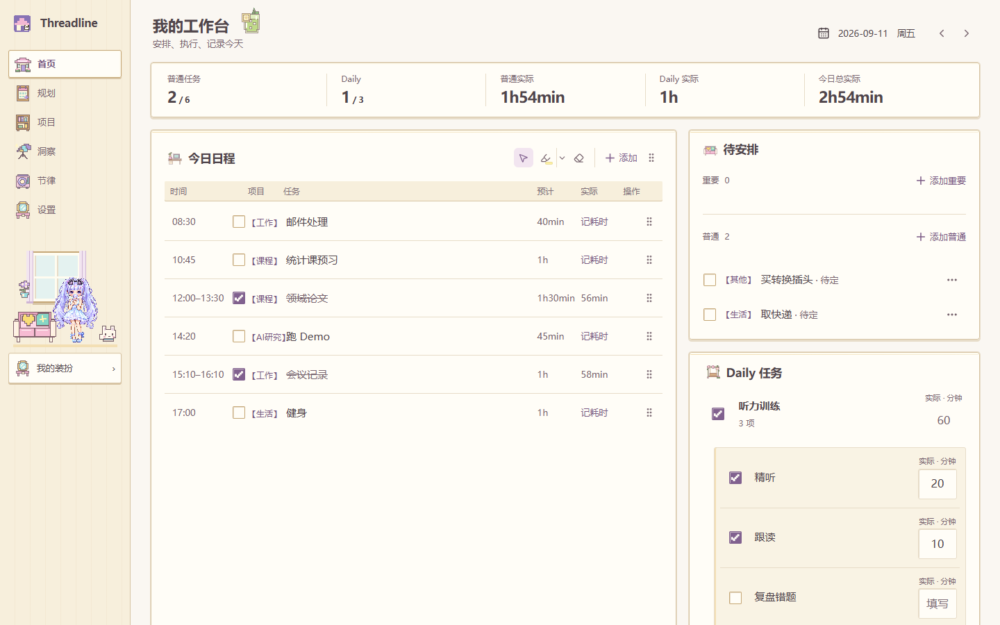
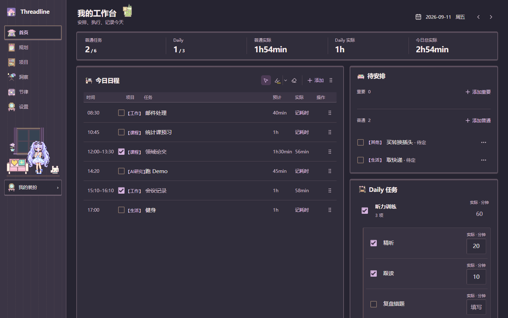
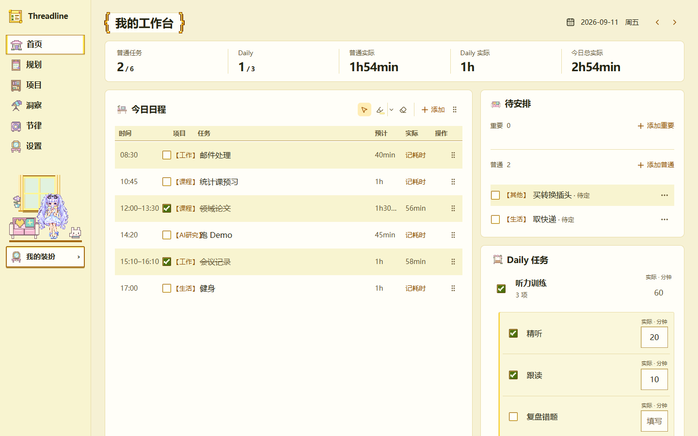
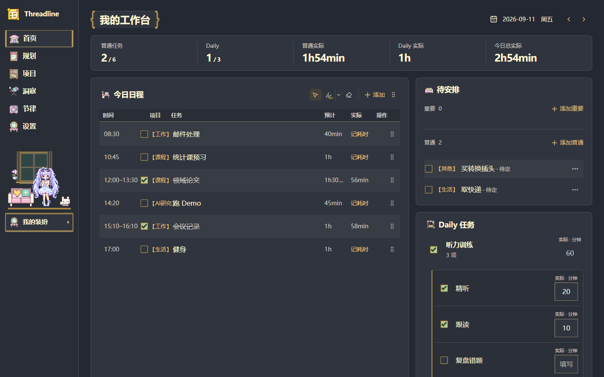

<!-- 文件用途：介绍 Threadline 的核心体验、使用入口与开发文档，作为仓库的产品首页。 -->

<p align="center">
  
</p>

<h1 align="center">Threadline</h1>

<p align="center"><strong>安排今天，也留住认真生活的痕迹。</strong></p>
<p align="center">把任务、长期计划、日常清单与时间记录放在一起的个人工作台。</p>

<p align="center">
  <a href="https://github.com/Doris619619/Threadline/releases/latest">下载 Windows 版</a> ·
  <a href="#开始使用">开始使用</a> ·
  <a href="#本地开发">本地开发</a> ·
  <a href="#文档导航">文档</a> ·
  <a href="https://github.com/Doris619619/Threadline/issues">反馈</a>
</p>

<p align="center"><sub>桌面浏览器 · iPhone PWA · Windows 桌面应用</sub></p>



<p align="center"><sub>默认蓝色 · 2026-09 外观样例 · 虚构演示数据</sub></p>

## 能做什么

- **安排今天**：在首页管理今日日程与待安排，填写预计时长、勾选完成，在日历中查看安排和调整日期。
- **推进长期计划**：把目标拆成阶段清单，按项目组织任务；点击「→ 今天」即可安排执行，阶段、项目与日程共享同一条任务。
- **看见真实投入**：同时使用最多三个正计时或倒计时器，到时可续时；新计时保存后，重叠时段在总量中只算一次，时间分布按任务均分。原始分钟和历史记录保留，详见[计时统计规则](docs/timer-accounting.md)。
- **照顾日常节奏**：用 Daily 管理重复清单，用习惯页记录起床、睡觉和效率，查看周/月趋势；节律页另行记录生理期。
- **和一个人一起坚持**：通过邀请码绑定好友或情侣，在「我们的自习室」或「同频」中写下目标、互相加油，由对方验收成果声明。
- **让任务留在手边**：Windows 工作站支持置顶与贴边收起，需要全局规划时再打开完整工作台。
- **随时看见计时**：Windows 的完整工作台、工作站和计时站三种视图互斥，同一时间只显示一个。计时站支持横向／纵向紧凑卡片，拖动边框或角落可调整宽高（最窄 200 逻辑像素，窄窗标题栏自动分两行），松开后窗口高度贴合卡片、收掉底部空白；卡片内容整体适配并完整显示所有计时器，同时分别记住两种排列的尺寸。支持置顶、暂停、继续、续时和完成记账。项目与任务同排，绿色向上表示正计时，红色向下表示倒计时，每张卡片显示首次开始时间。标题栏通过“打开完整工作台”文字按钮返回完整工作台，切换或关闭计时站均保留计时，详见[计时站](docs/timer-station.md)。

## 开始使用

| 使用方式       | 怎么开始                                                                                                                    |
| :------------- | :-------------------------------------------------------------------------------------------------------------------------- |
| **Windows**    | 前往 [最新 Release](https://github.com/Doris619619/Threadline/releases/latest)，下载以 `x64-setup.exe` 结尾的安装包并安装。 |
| **桌面浏览器** | 打开已部署的 Threadline 网站；自行搭建请看 [云端与 Web 部署](docs/supabase-deployment.md)。                                 |
| **iPhone PWA** | 用 Safari 打开已部署的 HTTPS 网站，选择「分享 → 添加到主屏幕」。                                                            |

使用部署管理员提供的账号登录。首次进入可选择主题和个人设置；在 **设置 → 日期与时区** 选择账号时区，各设备的日期和打卡会按这一时区运行。

任务、项目、阶段、Daily 与习惯等账号数据通过 Supabase 同步。主题、字体、批注和进行中的计时器状态保存在本机；计时完成后保存的实际投入会同步。日常编辑与同步需要网络，PWA 缓存的是应用壳。

保存时保持按钮文字和页面布局稳定，等待期间防止重复提交；失败会保留草稿与重试提示。具体行为见 [交互反馈说明](docs/interaction-feedback.md)。

Windows 正式安装版支持检查更新，在 **设置 → 关于 Threadline** 中也可手动检查；下载新版后，由你确认重启安装。旧版或目录预览的升级方式见 [自动更新说明](docs/desktop-auto-update.md)。

## 让工作台更像你

四套主题：**默认蓝色、安妮雅、皮卡小屋、皮卡经典**。搭配浅色 / 深色模式，以及默认字体、思源黑体或思源宋体，在 **设置 → 外观** 中自由组合。皮卡主题还可以通过「我的装扮」选择穿搭，和白猫互动。

<details>
<summary><strong>查看四套主题的浅色与深色预览</strong></summary>

<table>
<tr>
  <td width="50%" align="center"><a href="docs/screenshots/readme/blue-light.png"></a><br /><sub>默认蓝色 · 浅色</sub></td>
  <td width="50%" align="center"><a href="docs/screenshots/readme/blue-dark.png"></a><br /><sub>默认蓝色 · 深色</sub></td>
</tr>
<tr>
  <td width="50%" align="center"><a href="docs/screenshots/readme/anya-light.png"></a><br /><sub>安妮雅 · 浅色</sub></td>
  <td width="50%" align="center"><a href="docs/screenshots/readme/anya-dark.png"></a><br /><sub>安妮雅 · 深色</sub></td>
</tr>
<tr>
  <td width="50%" align="center"><a href="docs/screenshots/readme/cottage-light.png"></a><br /><sub>皮卡小屋 · 浅色</sub></td>
  <td width="50%" align="center"><a href="docs/screenshots/readme/cottage-dark.png"></a><br /><sub>皮卡小屋 · 深色</sub></td>
</tr>
<tr>
  <td width="50%" align="center"><a href="docs/screenshots/readme/classic-light.png"></a><br /><sub>皮卡经典 · 浅色</sub></td>
  <td width="50%" align="center"><a href="docs/screenshots/readme/classic-dark.png"></a><br /><sub>皮卡经典 · 深色</sub></td>
</tr>
</table>

点击图片可查看原图；截图来源见 [外观预览说明](docs/screenshots/readme/README.md)。

</details>

## 本地开发

需要 **Node.js ≥ 22.12.0**、**pnpm 11.19.0** 和一个 Supabase 项目。

```powershell
git clone https://github.com/Doris619619/Threadline.git
cd Threadline
pnpm install
Copy-Item .env.example .env.local
# 填写 .env.local 中的 Supabase 公开配置，并按部署指南完成数据库迁移
pnpm dev
```

打开 <http://localhost:3000>。环境变量、账号创建与迁移步骤见 [开发指南](docs/development.md) 和 [部署指南](docs/supabase-deployment.md)。

常用检查：

```powershell
pnpm lint
pnpm typecheck
pnpm test
```

Windows 开发使用 `pnpm desktop:dev`；构建、打包和完整验证命令见 [Windows 构建指南](docs/WINDOWS_BUILD.md) 与 [测试架构](docs/testing-architecture.md)。

Windows 包仅携带桌面运行所需依赖，以及简体中文、繁体中文和英文的 Electron 语言资源；四套主题、两套思源字体和自动更新能力均保留。

### 架构

前端使用 **Next.js App Router、React、TypeScript**，三种使用方式共享 UI 与业务逻辑。

| 运行端    | 承载方式                                                                     |
| :-------- | :--------------------------------------------------------------------------- |
| Web / PWA | Next.js 服务模式，提供浏览器工作台与 PWA 应用壳。                            |
| Windows   | Electron 加载独立静态导出的前端，Main / Preload 提供窗口管理与受限原生能力。 |

云端由 Supabase 提供认证、PostgreSQL 数据存储与 Realtime 同步，通过 RLS 隔离账号数据。目录结构与构建边界见 [开发指南](docs/development.md)。

## 文档导航

| 想了解什么           | 从这里开始                                                                                                                                                        |
| :------------------- | :---------------------------------------------------------------------------------------------------------------------------------------------------------------- |
| 任务、日历与阶段计划 | [产品交互](docs/interaction-reference.md) · [任务规划](docs/task-planning.md) · [阶段计划](docs/stage-plans.md)                                                   |
| 习惯与个人设置       | [习惯规则](docs/habits.md) · [首次使用与设置](docs/首次使用与个人设置.md) · [账号时区](docs/habits-layout-timezone.md)                                            |
| 两人空间             | [使用与部署](docs/together-space.md)                                                                                                                              |
| 外观与装扮           | [主题与字体](docs/appearance.md) · [皮卡小屋](docs/pixel-cottage.md) · [皮卡经典](docs/pika-classic.md)                                                           |
| 本地开发与测试       | [开发指南](docs/development.md) · [测试架构](docs/testing-architecture.md)                                                                                        |
| 云端部署与数据安全   | [Supabase / Vercel](docs/supabase-deployment.md) · [数据完整性](docs/data-integrity.md) · [数据安全修复记录](docs/issue-49-regressions.md)                        |
| Windows 构建与使用   | [本地打包](docs/WINDOWS_BUILD.md) · [窗口与工作站](docs/desktop-window-modes.md) · [自动更新](docs/desktop-auto-update.md) · [启动恢复](docs/startup-recovery.md) |

## 反馈与贡献

遇到问题或有功能建议，欢迎 [提交 Issue](https://github.com/Doris619619/Threadline/issues)。反馈时请附使用平台、版本与复现步骤。

参与开发前，请阅读 [工程协作规范](docs/工程协作规范.md)；提交 Pull Request 时遵守 [PR 撰写规范](docs/PR撰写规范.md)。

[查看版本记录与下载](https://github.com/Doris619619/Threadline/releases)
